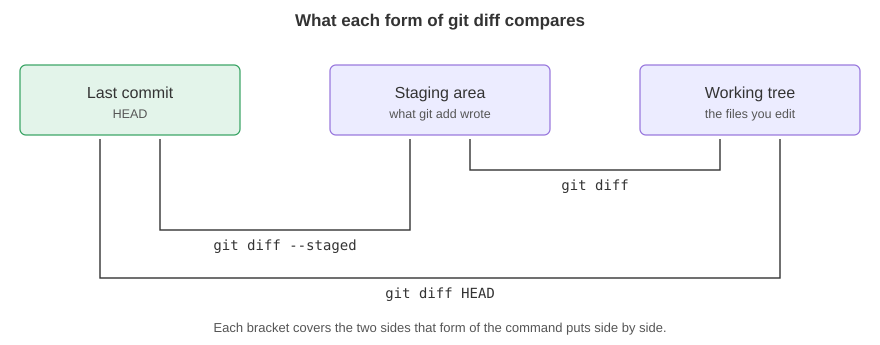

----

# **`Understand Git and Github`**
-----


### **What is Git and Github**


### **Difference between Git and Github**


### **Why need Git and GitHub**


### **Install Git according to Your System**


- To check if git is installed properly run this command in CMD.
```bash
git --version
```

### **Set Up git in Your System**
- In order to use git fiirdt time in your system use these two command in cmd to set up git


### **Your first Git repository**


### **Branching in Git and Github**


- Only `.git` is new, and the folder holds nothing but that. Everything Git keeps for the project sits inside it, which ls .git lists.


### **Reading status in an empty repository**


### **Where you run git init**


### **Staging and committing**


### **Staging the file with git add**


```bash
git add .
```

### **Making the first commit**

```bash
git commit -m "Add a README for the docs assistant"
```


### **Taking a change back out of the staging area**


### **Working tree compared with staging area and repository**


### **Reading git status**


### **The three sentences status ends with**


### **.gitignore**


### **Looking at history with git log**


```bash
git log                 # every commit, newest first
git log --oneline -n 5  # the last five, one line each
```


### **One line per commit**

```bash
git log --oneline
```

### **Seeing what changed with git diff**




```bash
git diff            # the folder against the staging area
git diff --staged   # the staging area against the last commit
git diff HEAD       # the folder against the last commit
```

- The same change again. git diff HEAD compares the folder with the last commit and ignores the staging area in between, so staging makes no difference to it.


### **Writing a commit message**


### **Writing a commit message**


### **Branches**


- Syntax: the same command lists branches, creates one, and deletes one.
```bash
git branch                 # list them, with a star on the one you are on
git branch <name>          # create a branch pointing at the current commit
git branch -d <name>       # delete a branch that has been merged
```