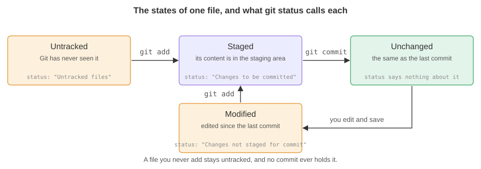
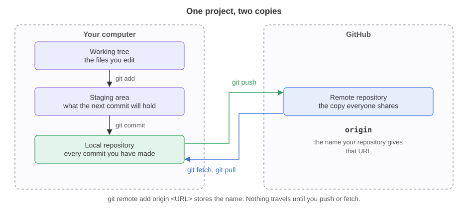
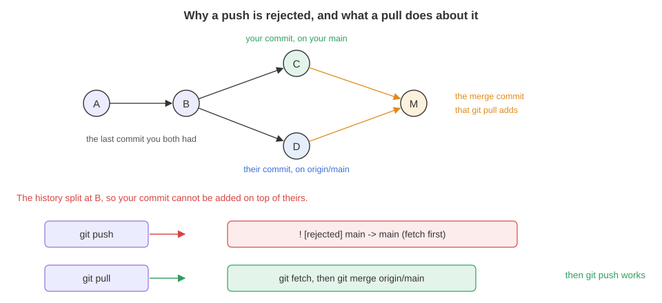
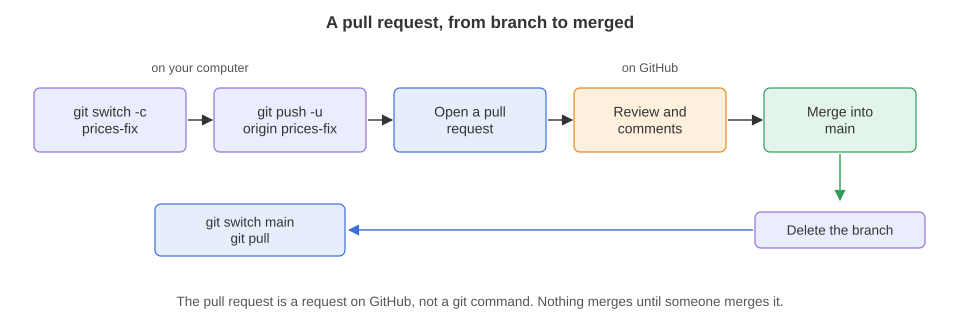

----

# **`Understand Git and Github`**
-----


### **What is Git and Github**


### **Difference between Git and Github**


### **Why need Git and GitHub**


### **Install Git according to Your System**


- To check if git is installed properly run this command in CMD.
```bash
git --version
```

### **Set Up git in Your System**
- In order to use git fiirdt time in your system use these two command in cmd to set up git


### **Your first Git repository**


### **Branching in Git and Github**


- Only `.git` is new, and the folder holds nothing but that. Everything Git keeps for the project sits inside it, which ls .git lists.


### **Reading status in an empty repository**


### **Where you run git init**


### **Staging and committing**


### **Staging the file with git add**


```bash
git add .
```

### **Making the first commit**

```bash
git commit -m "Add a README for the docs assistant"
```


### **Taking a change back out of the staging area**


### **Working tree compared with staging area and repository**


### **Reading git status**




### **The three sentences status ends with**


### **.gitignore**


### **Looking at history with git log**


```bash
git log                 # every commit, newest first
git log --oneline -n 5  # the last five, one line each
```


### **One line per commit**

```bash
git log --oneline
```

### **Seeing what changed with git diff**


```bash
git diff            # the folder against the staging area
git diff --staged   # the staging area against the last commit
git diff HEAD       # the folder against the last commit
```

- The same change again. git diff HEAD compares the folder with the last commit and ignores the staging area in between, so staging makes no difference to it.


### **Writing a commit message**


### **Writing a commit message**


### **Branches**


- Syntax: the same command lists branches, creates one, and deletes one.
```bash
git branch                 # list them, with a star on the one you are on
git branch <name>          # create a branch pointing at the current commit
git branch -d <name>       # delete a branch that has been merged
```


### **Switching branches**


- Syntax: git switch arrived in Git 2.23 for exactly this job. git checkout still does it and is what you will see in older material.

```bash
git switch <name>       # move to an existing branch
git switch -c <name>    # create it and move to it in one step
git switch -            # back to the branch you were on before
git checkout <name>     # the older command, same move
git switch --detach     # move to previous commit
```

### **Merging a branch**


- An experiment that worked has to come back. Merging is how: you stand on the branch that should receive the work, name the branch that has it, and Git joins the two lines of history. There are two ways it can end, and the output tells you which one happened.

```bash
git switch main            # the branch that receives the work
git merge chunk-800        # the branch whose commits come in
git merge --no-edit <name> # keep Git's prepared message, open no editor
```
### **A merge that makes a commit**

- Both names are on different commits, and neither is reachable from the other. There is no name to move forward, so Git has to join the two lines instead.

```bash
git merge --no-edit chunk-800
```
### **Tidying up after a merge**

```bash
git branch -d chunk-800
```
### **Where you merge**


### **Resolving merge conflicts**

- Most merges finish on their own. Git only stops when the two sides changed the same lines, and then it hands the file back to you with both versions in it, marked. Nothing is lost and nothing is broken. The job is to edit the file into the version you want and commit it.


### **What Git does when it cannot decide**
- The merge runs, finishes what it can, and stops on the file it cannot finish.


### **Git remotes**



**`Syntax`**: every form of git remote you will use.

```bash
git remote add origin <URL>         # give a URL the name origin
git remote -v                       # list the remotes, with their URLs
git remote rename origin github     # change a remote's name
git remote set-url origin <URL>     # point an existing name at a different URL
git remote remove github            # forget a remote
```


### **GitHub authentication**


### **Pushing and pulling**



```bash
git push -u origin main    # send branch main to origin, and remember the pairing
git push                   # after -u once, this is enough
git fetch origin           # download what the remote has, change nothing you are working on
git pull                   # git fetch, then merge what came down into your branch
```


### **Cloning a repository**


- `Syntax`: the forms of git clone worth knowing.
```bash
git clone <URL>                  # into a new folder named after the repository
git clone <URL> my-folder        # into a folder you name
git clone --branch dev <URL>     # start on the dev branch instead of the default one
git clone --depth 1 <URL>        # the latest commit only, not the whole history
```

### **Cloning against init plus remote**


### **Pull requests**



- The name is a request to the project to pull your branch in. GitHub's docs put one rule on it: “Pull requests can only be opened between two different branches”. The branch you want merged is the compare branch; the branch it should land in is the base.